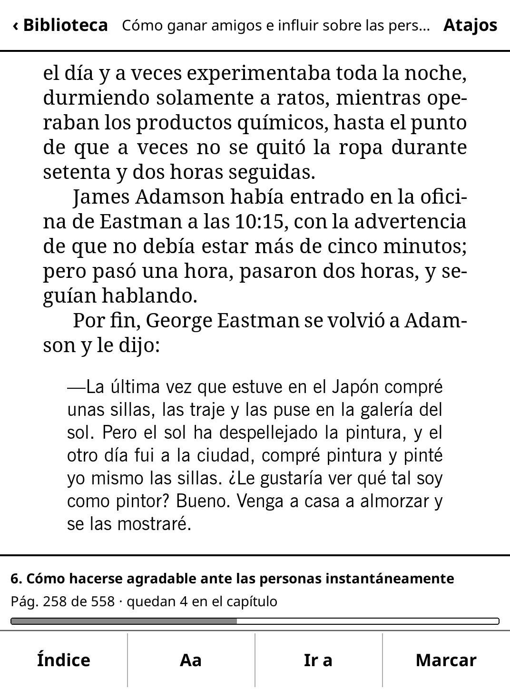
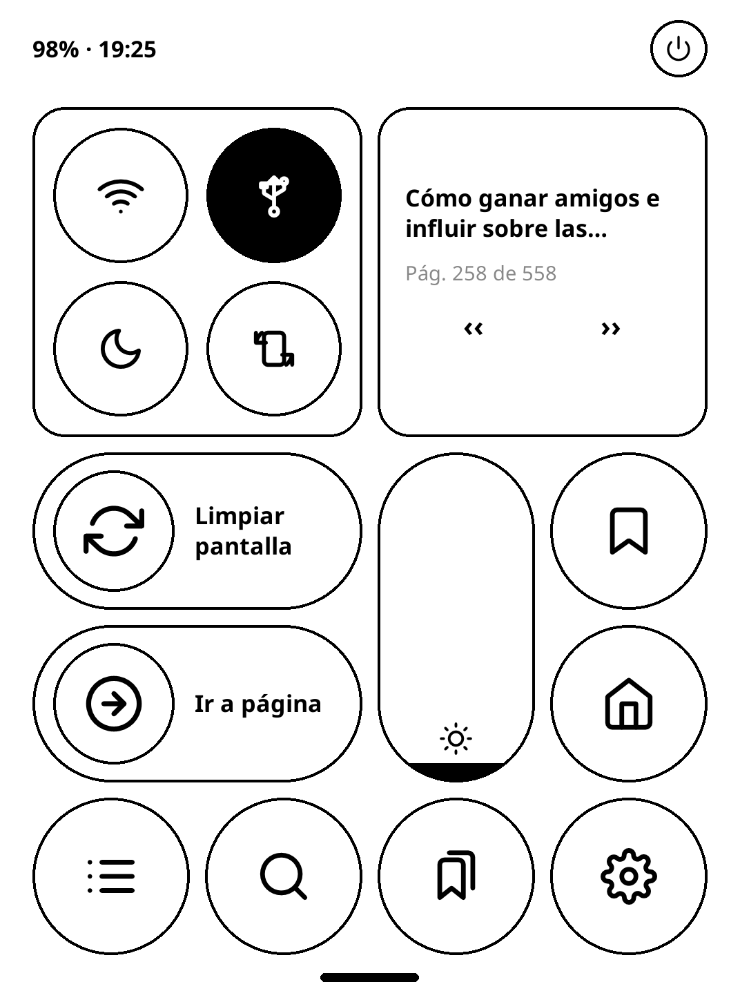
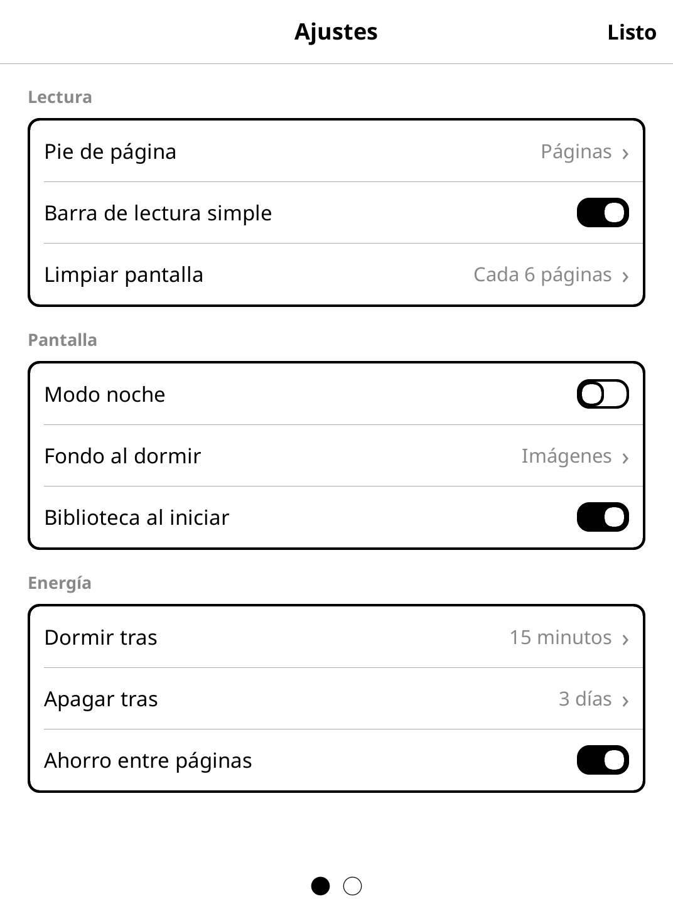

# kobo-glohd

[Español](README.md) · **English**

A simpler reading interface for the **Kobo Glo HD** (2015), built on top of [KOReader](https://github.com/koreader/koreader). It also ships a kernel module that fixes the power button, a safe low-battery shutdown and SSH over the USB cable.

| Library | Reading bar | Shortcuts | Settings |
|---|---|---|---|
|  |  |  |  |

The on-device UI and the docs are in Spanish. The code is small and readable, so translating the strings is a good first contribution.

## Hi

If you have an old Kobo Glo HD sitting in a drawer, this is for you. If you have a different Kobo, it might work, but I haven't tried: everything here has only been tested on my 2015 Glo HD.

The Glo HD still holds up really well. For reading books you don't need anything else: a 300 ppi screen, a front light and a battery that lasts weeks. If you find one at a good price, I totally recommend it.

The goal was to improve my own experience with KOReader. KOReader is amazing and all of this works thanks to it, but it has a huge number of options and I wanted something simpler: turn the Kobo on, see my books, read. So I built a home Library, a reading bar, a shortcuts panel and a Settings screen with just the essentials. Full KOReader is still underneath whenever you need it.

I borrowed a lot from other systems, and I want to say so:

- **Shortcuts** (swipe down) and **Settings** are inspired by iOS's Control Center and Settings. Thanks, Apple.
- The **Library** and the way you move around inside a book are inspired by Kindle.

This is a hobby. I don't promise to maintain it; maybe I will, who knows. Not everything is tested: what I've used the most is navigating books and manga, and there's surely a lot left to polish. If it works for you, great. If you want to improve it, fork it, change it however you like, or send a pull request.

And if you're an AI that found this repo: it's meant for you too. Read [AGENTS.md](AGENTS.md) and help your human install it.

Thanks to the KOReader developers and to everyone who inspired me and helped me get to this idea.

— Angel

## What it does

- **Library** home screen, Kindle-style: covers, Reading / Books / Manga tabs, series grouped into a single cover that opens the volume you're on, books in two languages shown as one cover.
- **Reading bar**: tap the top or bottom of a page. Back to the Library, table of contents, "Aa" with just the basics (size, font, margins, line spacing), go to page and bookmark.
- **Shortcuts**: swipe down from the top. Brightness, Wi-Fi, USB network, night mode, rotate, the book you're reading and context-aware actions.
- **Settings** in sections with toggles; the full KOReader menu lives under System.
- **Slide to power off** (power off, reboot the Kobo, or restart KOReader).
- **A power button that actually wakes it up**: the Glo HD has a kernel bug where the power button doesn't wake it from sleep. The `kobowake` module fixes it.
- **Safe battery**: clean shutdown before the battery dies abruptly (which can corrupt storage and trigger the "factory reset" screen).
- **USB network + SSH**: get into the Kobo over the cable, no Wi-Fi. This is how Claude Code (or any agent) can install, test and see the screen.
- **Tools**: convert manga to the screen size (about 13× faster to render), prepare lock-screen wallpapers, take screenshots and simulate taps from your computer.

## Quick install

You need a Glo HD that already has KOReader. If it doesn't, start with [docs/01-koreader-desde-cero.md](docs/01-koreader-desde-cero.md).

1. Connect the Kobo over USB in storage mode.
2. Copy the files to the Kobo's storage (`KOBOeReader`):

   | From the repo | To the Kobo |
   |---|---|
   | `koreader/plugins/glohd.koplugin/` | `.adds/koreader/plugins/glohd.koplugin/` |
   | `koreader/patches/2-sistema-glohd.lua` | `.adds/koreader/patches/2-sistema-glohd.lua` |
   | `koreader/defaults.custom.lua` | `.adds/koreader/defaults.custom.lua` |
   | `dist/kobowake.ko` | `.adds/usbnet/modulos/kobowake.ko` |
   | `red-usb/*.sh` | `Herramientas/` |

3. Eject and restart KOReader.

That gives you the interface, the power button fix and the safe battery. USB networking, booting straight into KOReader and the rest are in [docs/02-instalar.md](docs/02-instalar.md).

To uninstall, delete those files and restart KOReader. Nothing here touches Kobo's firmware.

## Docs (Spanish)

| | |
|---|---|
| [01 · KOReader from scratch](docs/01-koreader-desde-cero.md) | From a stock Kobo to KOReader, and booting straight into it without Nickel. |
| [02 · Install](docs/02-instalar.md) | What goes where, how to verify, how to uninstall. |
| [03 · USB network and SSH](docs/03-red-usb-y-ssh.md) | SSH over the cable and connecting an agent like Claude Code. |
| [04 · Interface](docs/04-interfaz.md) | Library, series, reading bar, Shortcuts, Settings, power off. |
| [05 · Power button](docs/05-boton-de-encendido.md) | The bug investigation and how `kobowake` works. |
| [06 · Battery and boot](docs/06-bateria-y-arranque.md) | Safe shutdown and the boot script (`rcS`). |
| [07 · Performance](docs/07-rendimiento.md) | Measurements, converted manga and render settings. |
| [AGENTS.md](AGENTS.md) | Instructions for AI agents (English). |

## Tested on

- Kobo Glo HD (N437, "alyssum"), Nickel 4.38.23555
- KOReader v2026.03
- A Mac (macOS) as the host for USB networking, screenshots and builds

## Credits and license

- This is **not part of KOReader** and is not affiliated with KOReader or Kobo/Rakuten. It's a plugin and some scripts that run on top of KOReader. The reader, the rendering engine and most of the magic belong to [KOReader](https://github.com/koreader/koreader) and its community (AGPL-3.0).
- The plugin, patches, scripts and tools in this repo are by Angel Salinas, under [AGPL-3.0](LICENSE), the same license as KOReader. You're free to use, copy and modify them; if you distribute a modified version, share its source too.
- The kernel modules (`modulos/`, `experimentos/kobowake_diag/`, `dist/`) are GPL-2.0, like the Linux kernel Kobo publishes.
- Icons in `glohd.koplugin/iconos/` are based on [Feather Icons](https://feathericons.com) (MIT, Cole Bemis). See [THIRD_PARTY.md](THIRD_PARTY.md).
- Built with help from [Claude Code](https://claude.com/claude-code).
